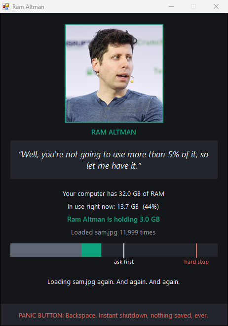
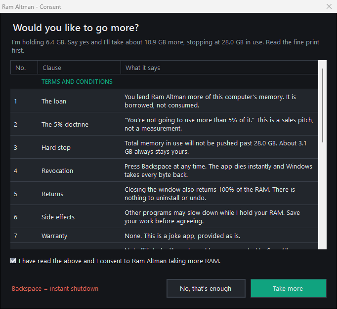
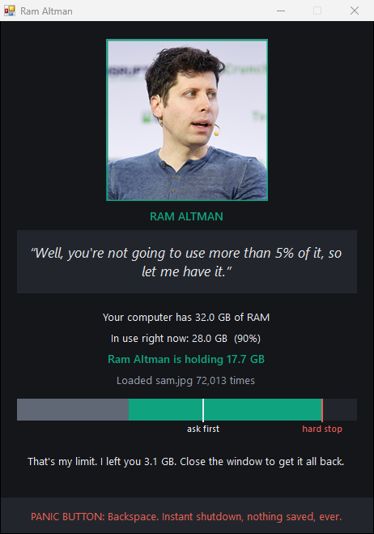

# Ram Altman

> "Well, you're not going to use more than 5% of it, so let me have it."

A parody app for Windows, Linux and macOS. Ram Altman looks at how much RAM your computer has and politely helps himself to it.

## Screenshots

| Filling up | Asking for consent | At the ceiling |
| :---: | :---: | :---: |
|  |  |  |

## Download

Get the package for your system from the [latest release](https://github.com/solvboy/ram-altman/releases/latest):

| System  | Package                          | How to run                         |
| ------- | -------------------------------- | ---------------------------------- |
| Windows | `RamAltman-<version>-windows.zip`    | Unzip, run `RamAltman.exe`         |
| Linux   | `RamAltman-<version>-linux.tar.gz`   | Extract, run `./ram-altman`        |
| macOS   | `RamAltman-<version>-mac.zip`        | Unzip, open `ram-altman.command`   |

Each version lives in its own folder with its own instructions: [windows](windows), [linux](linux), [mac](mac).

> **Known issue on macOS:** macOS blocks the downloaded app and says it could not verify that it is free of malware. This happens because the app is not signed with a paid Apple developer account, not because anything was found. See [mac/README.md](mac/README.md) for how to open it. Tracked in [issue #1](https://github.com/solvboy/ram-altman/issues/1).

## What it does

1. Shows the portrait, the quote, and how much RAM you have.
2. Slowly fills memory by loading the same picture file over and over, until the whole machine is at about 55% in use.
3. Stops and asks for consent, with terms and conditions, a privacy policy and a RAM budget in one table.
4. If you agree, keeps going up to a hard ceiling that always leaves one eighth of your RAM free (never less than 2 GB). On a 32 GB machine it stops at 28 GB.

## Stopping it

- **Backspace** is the panic button: the app dies instantly. The window must be focused; it stays on top so it is one click away.
- Closing the window does the same thing.

Either way the system takes every byte back immediately.

## Privacy

The app writes nothing: no settings, cache, logs, temp files or registry entries, and it has no networking code. Every launch is a first launch.

## Building the packages

`python package.py 1.0.0` writes the three packages to `dist/`. Build the Windows exe first with `windows\build.bat`.

## License and credits

- Code: [MIT](LICENSE). Free to use, edit and share.
- Photo: CC BY 2.0, TechCrunch. See [CREDITS.txt](CREDITS.txt).

This is a parody. It is not affiliated with or endorsed by Sam Altman, OpenAI or TechCrunch.
